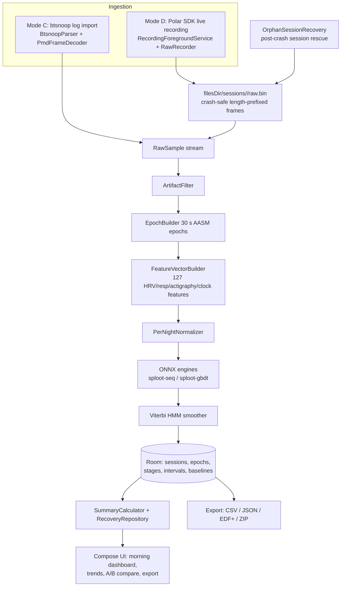

# Sploot

Overnight **cardiac-based sleep staging** for Android — record a full night from a
Polar H-series chest strap (HRV + actigraphy), stage it on-device with ONNX
models, and wake up to a hypnogram, sleep summary and a recovery score.
**100% local: no account, no cloud, no telemetry.**

## Architecture



| Layer | Location |
|---|---|
| BLE + Polar SDK client | `app/src/main/java/com/example/sploot/ble/` |
| Raw recording (service, logger, recovery) | `.../recording/` |
| Signal pipeline (filter, epochs, features) | `.../signal/`, `.../features/` |
| ONNX staging + HMM smoothing | `.../ml/` |
| Room schema, repositories, summary | `.../data/` |
| Compose UI | `.../ui/` |
| btsnoop import tooling | `.../ble/snoop/`, [docs/snoop_import.md](docs/snoop_import.md) |
| Python training pipeline | [ml_pipeline/](ml_pipeline/) ([README](ml_pipeline/README.md)) |

## Setup

1. Open the repo root in **Android Studio** (Ladybug or newer, AGP/Gradle via
   `gradle/libs.versions.toml`), JDK 17.
2. Let Gradle sync (dependencies incl. the Polar SDK from JitPack).
3. Run the `app` configuration on a device with Bluetooth LE (recording needs
   a real device; unit tests run on the JVM).

## Usage

### Recording a night (Mode D)
1. Wear the Polar strap, open Sploot → **Scan for devices** → **Pair**.
2. Tap **Start overnight recording** — a foreground service with partial
   wakelock records IBI/ACC/ECG into a crash-safe binary log.
3. In the morning tap **Stop recording**; processing runs automatically
   (decode → filter → epochs → features → staging → summary) and lands on the
   **morning dashboard**.

If the phone died mid-night, the next app open offers **Recover & process**
for any interrupted session (detected via `index.json` without an end stamp).

### Snoop import (Mode C)
Capture the Android btsnoop_hci.log of a Polar recording session and import
it post-hoc — see [docs/snoop_import.md](docs/snoop_import.md). The decoded
samples flow through the exact same pipeline as Mode D.

### Fully automatic morning flow (Phase 12 — Shizuku)

With the one-time setup done, mornings require exactly one action: **open Sploot**.

- **One-time:** keep Bluetooth HCI snoop logging enabled (developer options),
  install [Shizuku](https://shizuku.rikka.app), start it via wireless debugging,
  and grant Sploot permission (Settings → *Automatic capture* → *Grant via
  Shizuku*; a *Test fetch now* button shows bytes/packets/Polar-share or the
  exact failure reason).
- **Nightly:** nothing — Android's stack writes the snoop log while you sleep².
- **Morning:** open Sploot. The app fetches the log itself (Shizuku shell
  `cat` → `bugreportz` zip stream-extraction → manual SAF import as last
  resort), skips it via a size+SHA-256 fingerprint when nothing changed, runs
  the full staging pipeline in the background, and posts a morning summary
  notification (sleep, deep/REM minutes, recovery score). A shrunk log raises
  a rotation warning. A one-tap *Capture last night* button on the Record tab
  triggers the same flow manually. Details in
  [docs/snoop_import.md](docs/snoop_import.md#5-fully-automatic-morning-flow-phase-12--shizuku).

### A/B comparison
Dashboard → **A/B compare** lets you paste or pick a reference hypnogram
(`epoch,stage` or `time,stage`; W/N1/N2/N3/R or 0–3) and shows concordance,
Cohen's κ, per-stage duration deltas, coverage % and a 4×4 confusion matrix.
Mismatched lengths are handled by epoch-index intersection with a reported
coverage %.

## Replacing the placeholder models

The bundled ONNX models are **placeholders** (uniform-ish priors) until the
NSRR-trained models are produced by the Python pipeline. To install real ones:

1. Follow [ml_pipeline/README.md](ml_pipeline/README.md) — download NSRR data,
   build the dataset, train the sequence + GBDT models, learn the HMM
   transitions, run `package_assets.py`.
2. Copy the packaged artifacts over the app assets, or push them to a device:
   ```bash
   adb push sploot-seq.onnx sploot-seq.json sploot-gbdt.onnx sploot-gbdt.json \
       hmm_transition.json features_manifest.json \
       /sdcard/Android/data/com.example.sploot/files/models/   # or rebuild the APK
   ```
   Rebuilding (`./gradlew assembleDebug`) is the recommended path — the assets
   are versioned together with the feature manifest.

## Privacy

**Everything stays on the device.** Raw recordings, derived features, stages
and summaries live in app-private storage and Room; export is user-initiated
via SAF to a folder you choose. There is no network code beyond the Polar BLE
link; no analytics, crash reporting or tracking of any kind.

## Current limitations

- **Placeholder models** — sleep stages are near-uniform priors until NSRR
  training lands (see above); summaries/HRV metrics are already real.
- **Parquet skipped** — exports are CSV/JSON/EDF+/zipped-CSV; see the decision
  note in `ExportManager`.
- **Modes A/B deferred** — Apple Watch / third-party app import routes are not
  implemented (plan: `plans/sleep-staging-architecture.md`).
- Sleep staging is not a medical device; for research/curiosity only.

## Testing

```bash
./gradlew testDebugUnitTest   # ~140 JVM unit tests incl. an 8 h synthetic-night
                             # end-to-end regression (FullNightPipelineTest)
./gradlew lint                # Android lint
./gradlew assembleDebug       # debug APK
```

## 2026-11-01 — Shizuku snoop fetch: root cause & fix

On-device debugging showed the Shizuku fetch failure had two independent causes:

1. **Shizuku server not actually running.** The wireless-debugging-started
   `shizuku_server` process dies whenever the wireless debugging session drops
   (screen lock cycles, ANR dialogs). The manager UI can still show "started"
   stale. Sploot's "Shizuku is not running" message was truthful — restart
   Shizuku from its app (Step-by-step guide → Start) when this happens.
2. **SIGPIPE misclassified as a fetch failure** (the real code bug). On devices
   where `/data/misc/bluetooth/logs` is unreadable for uid shell (Samsung: all
   three direct paths return `ls: exit 1`), the fallback is `bugreportz -p` +
   streamed zip extraction. The extractor deliberately stops reading once the
   btsnoop entry is complete, which SIGPIPEs the upstream `cat` (exit 141).
   `SnoopAutoFetcher.fetchViaBugreportz` treated that as "stream ended early"
   and deleted a perfectly good capture. Exit 0/141/13 after a magic-verified
   extraction is now accepted as success; any other exit remains a failure.
   Regression-tested in `SnoopAutoFetchTest` against the exact on-device trace.

Verified end-to-end on the device (Galaxy, Shizuku 13.6): "Fetched 2976675
bytes via BUGREPORTZ (bugreport zip 11755520 B) — 14004 snoop records, 118 ATT
notifications". Shizuku server stayed alive and responsive throughout (no ANR).
No UserService/AIDL code runs inside Shizuku; fetching uses
`IShizukuService.newProcess` (streamed stdout, background stderr drain).

## 2026-11-13 — Phase 13: dreamlike, quiet, koala-adjacent redesign

Taste-level pass. The koala retreats; its world steps forward.

- **Icon**: the shape IS the koala head — flat minimal silhouette with
  closed sleeping eyes, keyed to full transparency (adaptive background
  `#00000000`, head at 60% of the 108 dp canvas inside the safe zone;
  legacy webps are RGBA head-only). Keying: flood-fill from the image
  borders + soft edge ramp + un-premultiply → no white halo at any size.
  See `tools/branding/README.md` for regeneration.
- **In-app art**: the single koala presence is a ~10%-alpha ghost head in
  the Home header. The three literal koala webps are gone. Empty states
  use a hand-authored eucalypt-sprig vector; the Home header is a
  misty-eucalypt/moonlight watercolor wash that fades into the surface.
- **UI**: Home header is airy typography over the wash (no banner card);
  Dashboard is an editorial flow — borderless hero hypnogram, floating
  quiet metrics ("asleep 7h 12m"), one soft stage proportion bar instead
  of four cards, tonal-wash night rows; bottom nav is transparent with
  lowercase labels and a soft dot as the only active indication;
  hypnogram lost its gridlines (faint baseline only) and softened its
  bands. Copy is quiet lowercase throughout ("last night", "sleep well").
- No functional changes; 151 unit tests, lint, assembleDebug, installDebug
  all green.
