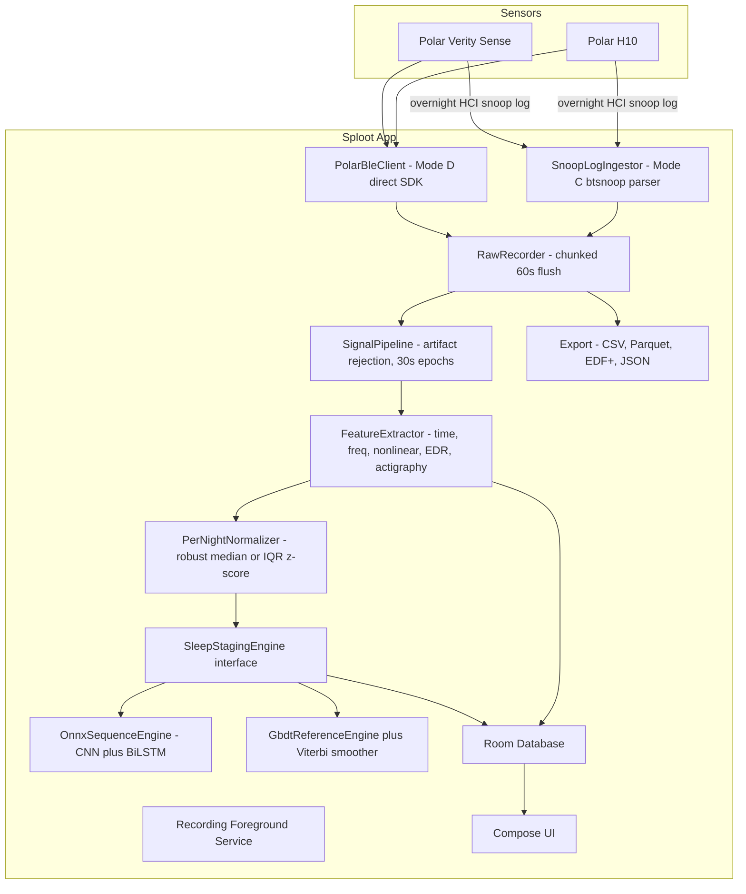

# Architecture Plan — Sploot: Clinical-Grade Autonomic Sleep Staging & Recovery App

## 0. Decisions Locked In (from user clarification)

- **Concurrency ingestion scope:** Mode D (Standalone Polar SDK) + Mode C (post-night `btsnoop_hci.log` parser). Modes A (passive GATT listener) and B (BLE proxy/relay) are deferred — the parser interface is designed so they can be added later without refactoring.
- **ML runtime:** ONNX Runtime only. Sequence model (1D ResNet/CNN + Bi-LSTM or Attention) as primary engine; HMM/Viterbi-smoothed gradient-boosted tree model as reference/fallback engine. Python pipeline trains/converts models against SHHS/MESA (NSRR).
- **Platform baseline:** Existing project `Sploot`, package `com.example.sploot`, Kotlin 2.2.10, AGP 9.5, minSdk 26, targetSdk 37, Jetpack Compose + Material 3, dark circadian theme.
- **Implementation executor:** Orchestrator mode delegating **exclusively** to CMM-Code mode.

## 1. System Architecture Overview



### Module layout (single `:app` module first; extract Gradle modules only if build times demand it)

```
app/src/main/java/com/example/sploot/
├── MainActivity.kt
├── ble/
│   ├── PolarBleClient.kt          # Mode D: official polar-ble-sdk streams (PPI, ACC, ECG, HR)
│   ├── PolarDeviceRepository.kt   # discovery, pairing, battery, reconnection w/ exp backoff
│   └── snoop/
│       ├── BtsnoopParser.kt       # btsnoop_hci.log → ATT frames
│       ├── AttGattDecoder.kt      # map handles→UUIDs via SDP/notify chatter
│       ├── PmdFrameDecoder.kt     # Polar PMD: PPI, ACC delta frames, ECG, HR 0x2A37
│       └── SnoopIngestSession.kt  # produces same RawTick stream as Mode D
├── recording/
│   ├── RecordingForegroundService.kt  # connectedDevice type, wakelock, live notification
│   ├── RawRecorder.kt                 # 60s chunked flush, crash-safe, packet counter
│   └── SessionManager.kt
├── signal/
│   ├── ArtifactFilter.kt          # blocker/skin_contact flags, 300–2200ms bounds, Kubios-style 20%/5-beat median ectopic filter
│   ├── Interpolator.kt            # cubic spline / monotone cubic for gaps, 4Hz tachogram
│   ├── EpochBuilder.kt            # 30s AASM epochs
│   └── respiration/EdrExtractor.kt # RSA-based + ACC-based respiratory rate & RRV
├── features/
│   ├── HrvTimeDomain.kt           # meanIBI, SDNN, rMSSD, pNN50, SDSD, IQR
│   ├── HrvFrequencyDomain.kt      # Lomb-Scargle + Welch on 4Hz tachogram: VLF/LF/HF, LF/HF
│   ├── HrvNonlinear.kt            # Poincaré SD1/SD2, SampEn, DFA α1/α2
│   ├── ActigraphyFeatures.kt      # mean, var, MAD, ENMO, time-since-movement
│   └── FeatureVectorBuilder.kt    # 30s + 90s/150s/300s sliding context windows
├── ml/
│   ├── SleepStagingEngine.kt      # interface: ingest(features) → stages+probabilities
│   ├── OnnxSequenceEngine.kt      # onnxruntime-android, whole-night seq2seq
│   ├── GbdtReferenceEngine.kt     # converted tree model in ONNX format too (uniform runtime)
│   ├── ViterbiSmoother.kt         # HMM transition matrix post-processing
│   ├── PerNightNormalizer.kt      # robust median/IQR scaling across the night
│   └── ModelLoader.kt             # bundled asset + load-replaceable ONNX from local storage
├── data/
│   ├── db/ (Room): SessionEntity, EpochFeatureEntity, StageEntity, RawIntervalEntity, ComparisonEntity, DailyBaselineEntity
│   ├── export/ ExportManager (CSV, JSON, Parquet via parquet-java or arrow, EDF+ writer)
│   └── repo/ SessionRepository, RecoveryRepository
└── ui/
    ├── screens/ LiveRecordingScreen, MorningDashboardScreen, HypnogramScreen,
    │            AutonomicTrendsScreen, ABCompareScreen (κ, confusion matrix, duration deltas),
    │            SnoopImportScreen, SettingsScreen
    └── components/ HypnogramChart, HrvOverlayChart, NocturnalHrCurve, ScoreCards
ml_pipeline/ (Python, repo root)
├── download_nsrr.py       # SHHS/MESA fetch helper (user supplies NSRR token)
├── build_features.py      # mirrors Kotlin FeatureVectorBuilder exactly
├── train_sequence_model.py# PyTorch → ONNX
├── train_gbdt.py          # LightGBM → ONNX (onnxruntime treelite)
├── learn_hmm.py           # estimate transition matrix from training hypnograms
└── package_assets.py      # bundle .onnx + metadata JSON into app assets
```

## 2. Key Technical Choices

### BLE (Mode D)
- `com.polar:polar-ble-sdk` (+ `polar-ble-sdk-release` artifacts via mavenCentral/JitPack) wrapped behind `PolarBleClient`, exposing a unified `Flow<RawSample>` regardless of device (PPI from Verity Sense, RR via PMD `rr` stream from H10, ACC 52 Hz / ECG 130 Hz optional).
- Foreground service type `connectedDevice`, partial wakelock, battery-optimization exemption prompt, auto-reconnect with exponential backoff (1s→2s→…→60s cap), live notification (connection state, sensor battery, HR, packet count).

### Snoop ingestion (Mode C)
- Android "Bluetooth HCI snoop log" (Developer Options → bugreport contains `btsnoop_hci.log`). Parser reads the btsnoop format (16-byte record headers, HCI ACL → L2CAP → ATT), reconstructs GATT notification stream, resolves characteristic handles by observing `ATT_READ_BY_TYPE_RESP`/notification registration, then decodes PMD frames: frame type byte (0x008913 PPi, 0x008886 ECG, 0x008881 ACC delta-compressed, 0x008889 PPI) — exact sample structures replicated from Polar SDK source. Also decodes standard HR service 0x2A37 as fallback RR source. Output is the identical `RawSample` flow as Mode D, so downstream pipeline is mode-agnostic.

### Signal processing
- Pure Kotlin (no NDK needed at v1; DSP is trivially fast for these rates). Lomb-Scargle implemented natively to avoid FFT-on-irregular-sampling pitfalls. Interpolated 4 Hz tachogram + Welch as cross-check. If profiling shows hotspots, migrate `HrvFrequencyDomain` to C++ later — interface isolated for that.

### ML
- `onnxruntime-android` single runtime. Primary: PyTorch (1D CNN + Bi-GRU + attention) trained on SHHS+MESA HRV+actigraphy features → exported ONNX, whole-night sequence input. Reference: LightGBM → ONNX. Both emit per-epoch 4-class probabilities; `ViterbiSmoother` with learned HMM transitions enforces physiological plausibility. Model metadata JSON carries feature list/order + normalization scheme — `ModelLoader` validates compatibility.
- App ships with placeholder-but-functional models; retrain via `ml_pipeline/` when the user supplies NSRR-credentialed data.

### Data & export
- Room DB per spec; raw files written under app-private storage: `sessions/<id>/raw.bin` + rolling 60s flush, plus post-processing artifacts. Export: CSV/JSON native; EDF+ native writer (simple header format); Parquet via Apache Arrow/Parquet-java if dependency weight acceptable, else fall back to CSV bundle (decide during implementation).

## 3. Implementation Phases (each = one CMM-Code subtask)

1. **Gradle & skeleton:** add polar-ble-sdk, onnxruntime-android, Room, Navigation Compose, DataStore, security-crypto deps; create module package skeleton; app renames to "Sploot" branding.
2. **BLE + Recording service (Mode D):** PolarBleClient, reconnection, RawRecorder chunked flush, foreground service + notification, permission flows (BLUETOOTH_SCAN/CONNECT, POST_NOTIFICATIONS, battery exemption).
3. **Room schema + repositories + export** (CSV/JSON/EDF+ first).
4. **Signal pipeline:** ArtifactFilter, Interpolator, EpochBuilder, all feature extractors, unit tests with synthetic/physiological test signals.
5. **Snoop ingestion (Mode C):** btsnoop parser → ATT → PMD/HR decode → RawSample flow; unit tests with recorded fixture logs.
6. **ML layer:** SleepStagingEngine interface, ONNX engines, ViterbiSmoother, PerNightNormalizer, ModelLoader; placeholder ONNX models bundled.
7. **Python ml_pipeline/**: NSRR download, feature parity tests vs Kotlin, training scripts, ONNX export, asset packaging.
8. **UI:** Live Recording, Morning Dashboard (hypnogram + HR/HRV overlay + scores), Autonomic Trends (14–60d baselines), A/B Compare (κ, confusion matrix, sleep² import), Settings.
9. **Polish & hardening:** edge cases (sensor drop mid-night, empty sessions), integration test harness, README.

## 4. Risks & Mitigations

- **Polar SDK maven availability:** verify artifact coordinates early in Phase 1; fallback is direct GATT implementation against PMD service (the snoop parser already gives us the frame spec).
- **No public sleep²-grade pretrained weights:** expected; the ml_pipeline trains our own on SHHS/MESA with the user's NSRR account; app remains fully functional with reference engine until then.
- **btsnoop access requires bugreport on modern Android:** document user flow; parser also accepts pulled PCAP/CSV dumps.
- **Parquet on Android:** dependency-size risk; CSV/EDF+/JSON are guaranteed deliverables, Parquet best-effort.

## 5. As-Built (Phase 9, final — 2026-11-01)

Deviations from the original plan, recorded so the docs match reality:

- **Polar SDK 6.7.0 via JitPack** (`com.github.polarofficial:polar-ble-sdk`),
  not a mavenCentral artifact — resolved the Phase-1 availability risk with the
  documented repository rather than falling back to raw GATT.
- **Parquet → zipped CSV bundle.** parquet-java/arrow transitive weight +
  Hadoop shim conflicts on Android were judged a bad APK trade; the ZIP bundle
  of the CSV trio covers the same lossless-portability use case (decision note
  in `ExportManager`). Revisit only if a downstream toolchain demands columnar.
- **Placeholder models until NSRR training.** The bundled `sploot-seq` /
  `sploot-gbdt` ONNX assets are placeholder priors (near-constant
  probabilities → Viterbi yields mostly-Light nights). The full `ml_pipeline/`
  (dataset build, feature-parity golden tests, training, HMM learning, asset
  packaging) is ready; swapping the assets requires no app code change.
- **NaN feature semantics.** Epochs without usable signal produce NaN feature
  slots (per-feature `valid` flags in `EpochFeatures`); `PerNightNormalizer`
  imputes NaNs with column medians so the ONNX engines always receive finite
  input. Sessions where **no** epoch has usable HRV *and* ACC are still staged
  (defaults) but flagged in `SessionEntity.notes` as "insufficient data".
- **Edge-case hardening (this phase):** `ProcessNightUseCase` rejects
  <10-epoch sessions, zero-valid-IBI nights, and missing/corrupted `raw.bin`
  with user-comprehensible `ProcessingState.Error`s; truncated tail frames
  (process kill) are skipped by the raw reader. `OrphanSessionRecovery`
  detects un-finalized sessions on next app open (Home screen offers
  "Recover & process"). SAF permission loss mid-export surfaces a
  re-select-folder message instead of a `SecurityException` crash. A/B compare
  reports coverage % for mismatched lengths and supports timestamp-based
  alignment (`ComparisonCalculator.compareAligned`).
- **Modes A/B (Apple Watch / third-party import) remain deferred.**
- **Testing:** ~140 JVM unit tests incl. `FullNightPipelineTest` — an 8 h
  synthetic night with stage-dependent HRV/actigraphy dynamics run through the
  entire pipeline (filter → epochs → features → normalizer → both placeholder
  engines → Viterbi → summary) as the end-to-end regression guard.
